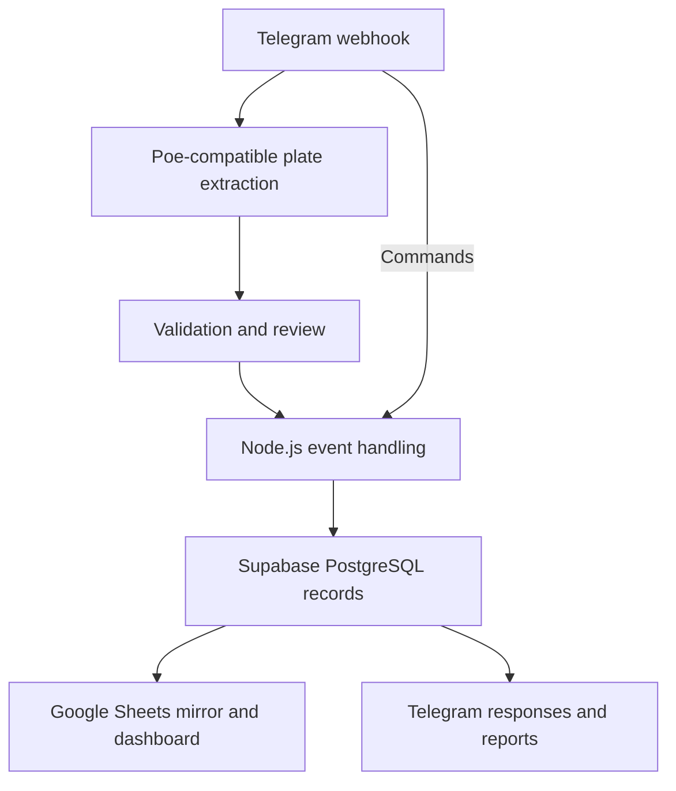

# Vehicle Operations Workflow

**Telegram photo intake → plate extraction → PostgreSQL vehicle records → Google Sheets reporting.**

A Node.js workflow for recording vehicle entry and exit, handling uncertain
plate readings, inspecting vehicles still on site and preparing operational
reports. PostgreSQL is the source of truth. The spreadsheet is a reporting view,
with its own refresh and failure handling.

[Concurrency case study](docs/CASE-CONCURRENT-FIRST-ENTRY.md) ·
[Database schema](supabase/schema.sql) ·
[Guard instructions — Vietnamese](docs/guard-instructions.md)

## Start with the engineering case

Two simultaneous photos of a plate with no active record could create two
entries: `SELECT FOR UPDATE` had no row to lock. The fix takes a transaction lock
for the plate before its lookup, while retaining the existing entry, duplicate
and exit decisions.

The [real PostgreSQL case](docs/CASE-CONCURRENT-FIRST-ENTRY.md) reproduces the
original failure through two database connections and a controlled insert
barrier. Five baseline rounds each create two active entries; the fixed function
preserves one entry under the same interleaving. Fresh-schema and migration
checks also cover independent plates, rollback, threshold boundaries and same-day
exit/re-entry. The [JSON evidence](docs/evidence/first-entry-fixed-upgrade.json)
contains actual actions, row counts, waits and source hashes.

## The workflow

1. A guard sends a vehicle photo through Telegram.
2. A Poe-compatible vision endpoint extracts the plate and vehicle model.
3. Validation sends missing, low-confidence or invalid readings to a review path.
4. The application records the event and calls the PostgreSQL vehicle-decision
   function. Its configurable minimum-stay threshold distinguishes a burst
   duplicate from an exit.
5. Database changes are mirrored to Google Sheets. A mirror failure is logged
   separately from the operational write.
6. Telegram commands, dashboard views and scheduled reports expose the records
   to the people using the workflow. Deterministic report rules remain separate
   from optional AI narrative generation and its fallback.



## Run the application

Use Node.js compatible with the locked dependencies and npm. Install the locked
tree without package lifecycle scripts:

```sh
npm ci --ignore-scripts
cp .env.example .env
```

Fill in the required settings in `.env`:

| Setting | Purpose |
| --- | --- |
| `TELEGRAM_BOT_TOKEN` | Bot credentials for intake and responses |
| `SUPABASE_URL`, `SUPABASE_SERVICE_KEY` | Privileged server connection to the operational database |
| `POE_API_KEY` | Plate-extraction provider credentials |
| `GOOGLE_SHEET_ID`, `GOOGLE_CREDENTIALS_JSON` | Spreadsheet and service-account credentials for reporting |

`src/config.js` is the configuration contract. The current OCR implementation is
[`src/ocr.js`](src/ocr.js); it uses a Poe-compatible chat-completions endpoint,
with `POE_OCR_MODEL` and optional `POE_API_ENDPOINT` settings. It does not use
Google Cloud Vision.

For a new database, review and apply `supabase/schema.sql` in the intended
Supabase project. For an existing database, use the ordered migration path and
review [migration 003](supabase/migrations/003-lock-plate-before-lookup.sql), which
also resolves the obsolete RPC overload. It does not delete or repair vehicle
records. The [database case](docs/CASE-CONCURRENT-FIRST-ENTRY.md#migration-behavior-matters-too)
explains dependency handling and the supported isolation contract.

Configure `TELEGRAM_WEBHOOK_SECRET` and `ADMIN_API_KEY`. Set
`TELEGRAM_WEBHOOK_URL` to the public server origin when you intend the application
to register its webhook. Then:

```sh
npm start
```

The application uses the configured providers and starts its periodic jobs.
For an isolated engineering check with no provider credentials or messages, use
the real-database test below instead.

## Check the behavior

### Node.js regression suite

```sh
npm test
```

The existing suite covers application helpers, mocked database/adapter behavior
and report paths. Database mocks do not establish PostgreSQL locking behavior.

### Real PostgreSQL concurrency check

Use Python 3, libpq and a disposable local PostgreSQL instance. Set the usual
`PGHOST`, `PGPORT`, `PGUSER` and `PGDATABASE` environment variables for a test
administrator with `CREATEDB`; the cluster must contain the schema's
`service_role` role.

```sh
python3 test/postgres-concurrency.py --json fixed-schema.json
python3 test/postgres-concurrency.py --upgrade --json fixed-upgrade.json
```

The harness creates a uniquely named disposable database and drops that exact
database after the check. It exercises the production SQL through separate real
connections. [The case study](docs/CASE-CONCURRENT-FIRST-ENTRY.md#run-against-your-own-disposable-local-postgresql)
includes the expected-failure command for the original function and the full
observed results.

## Source map

| Area | Source |
| --- | --- |
| Startup, webhook, routes and jobs | [`src/server.js`](src/server.js) |
| Validated configuration | [`src/config.js`](src/config.js) |
| Plate extraction | [`src/ocr.js`](src/ocr.js) |
| Vehicle events and review paths | [`src/matcher.js`](src/matcher.js) |
| Operational database adapter | [`src/db.js`](src/db.js) |
| Spreadsheet reporting mirror | [`src/sheets-sync.js`](src/sheets-sync.js) |
| Vehicle decision and migration history | [`supabase/`](supabase/) |
| Real database regression | [`test/postgres-concurrency.py`](test/postgres-concurrency.py) |
| Guard workflow | [`docs/guard-instructions.md`](docs/guard-instructions.md) |

The concurrency case was developed and checked with AI assistance. Its scope is
the local PostgreSQL RPC and surrounding database invariants; the case retains
the original failing behavior beside the checked fix.
